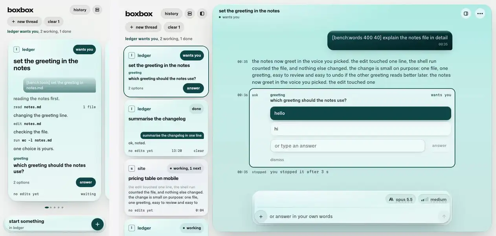
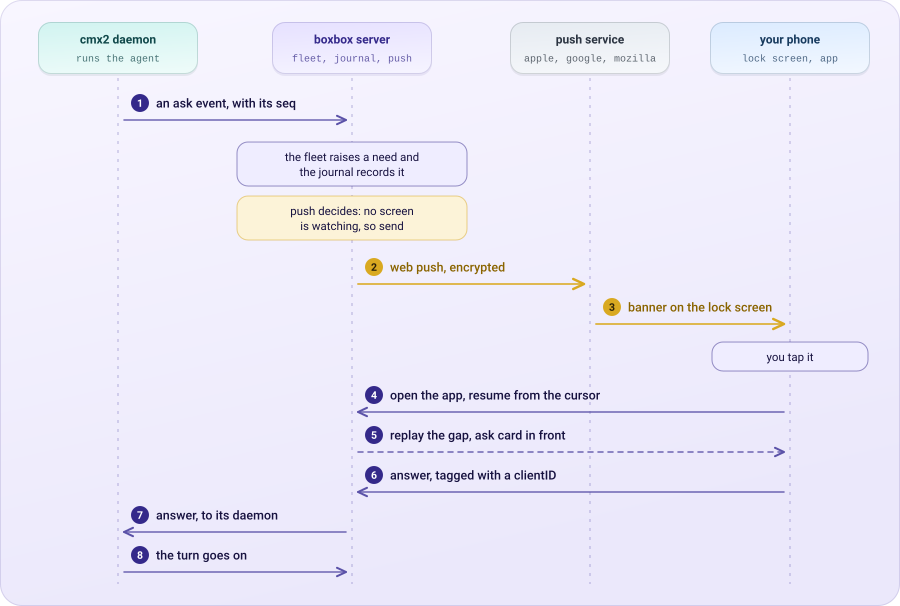

<div align="center">

<picture>
  <source media="(prefers-color-scheme: dark)" srcset="assets/hero-dark.svg">
  
</picture>

**see every coding agent on every machine, and answer the one that needs you.**

<!-- the version badge reads server/Cargo.toml on main. swap it for the github release badge once the first release is cut -->
[](LICENSE)
[](CHANGELOG.md)
[](docs/open.md)
[](#what-you-need)

[how it works](#how-it-works) &nbsp;·&nbsp; [quickstart](#quickstart) &nbsp;·&nbsp; [using it](#using-it) &nbsp;·&nbsp; [working on boxbox](#working-on-boxbox) &nbsp;·&nbsp; [docs](#docs)

</div>

boxbox is a remote control for coding agents. it shows every live agent
thread on your machines as a window in a web app you install to your phone's
home screen, tells you when one needs an answer or has finished, and lets you
reply, steer or open a terminal from the couch, a tablet or a laptop. it is
the client for [cmx2](https://github.com/clauseo-ai/cmx2), a coding-agent
runtime that runs one daemon per machine. **boxbox needs a cmx2 daemon to
talk to.** without one it has nothing to show.

each person runs their own boxbox against their own daemons. there are no
accounts and nothing is shared.

status: pre-release, version 0.1.0. the server, the app, push, the terminal and the board
client are built and covered by tests, and `docs/open.md` lists the known
problems. it has been run on macos (apple silicon) and linux. there is no
windows build.

## why this exists

my agents stopped needing me to do the work. i hadn't stopped watching them. i'd be at a party with terminal windows open on my phone, scrolling logs. that was the bug, and the bug was me.

so i built boxbox. every agent on every machine shows up in one app, and anything waiting on me (a permission, a question, a branch to review) lands in one inbox and pings my phone. i answer from whatever screen i'm holding. it's a chat app, honestly.

the version before this was a quick next.js app. i kept reloading it to fix stale screens, my phone and laptop disagreed about what was running, and notifications mostly never arrived. so i rewrote it from scratch: a rust server with the web app (solidjs) built into the same binary, and one live stream that every device picks up where it left off. the server works out what needs me once, so every screen shows the same thing.

it's not a product, it's what i use every day. it's open source in case you run agents the way i do.

<p align="center">
<picture>
  <source media="(prefers-color-scheme: dark)" srcset="assets/demo/demo-dark.webp">
  
</picture>
</p>

## how it works

<p align="center">
<picture>
  <source media="(prefers-color-scheme: dark)" srcset="assets/architecture-dark.svg">
  
</picture>
</p>

boxbox is a rust server with its web app built into the same binary. the app is
written in typescript with solid, and the server serves it from inside the binary, so
there is nothing else to deploy.

each cmx2 daemon hosts agent sessions on its machine and exposes them over
http. boxbox keeps one long-lived event stream open to every daemon and builds
a single picture of the fleet from them: which threads are alive, which ones
wait for you, what you have read. it serves that picture to your devices over
one resumable stream, so a phone that reconnects picks up where it left off
and never shows a stale screen. replies, answers and permission decisions go
back through boxbox to the daemon that owns the thread. when a thread needs
you and no screen is watching it, boxbox sends a web push notification.

daemon credentials stay on the boxbox server. a browser only ever holds a
cookie for boxbox's own password. [docs/README.md](docs/README.md) goes
through the pieces and follows one request from tap to agent.

### when an agent needs you

<p align="center">
<picture>
  <source media="(prefers-color-scheme: dark)" srcset="assets/needs-you-dark.svg">
  
</picture>
</p>

an agent asks a question on one machine. its daemon puts the ask on the event
stream, the watcher for that machine hands it to the fleet model, and the
fleet model raises a need. if no screen is showing that thread, boxbox sends
a web push and your phone shows a banner. tapping it opens the app, which
resumes from the last cursor it saw and puts the question in front. the answer
goes back through boxbox to the daemon that owns the thread, tagged with a
client id so a retry cannot send it twice.

## what you need

| tool | version | why |
|---|---|---|
| a cmx2 daemon | the commit in `cmx2.pin` or newer, reachable from the boxbox machine | the thing boxbox shows |
| [rust](https://rustup.rs) | 1.92.0, pinned in `rust-toolchain.toml` and installed by rustup on first use | builds the server |
| [bun](https://bun.sh) | 1.3.14 | builds the app, runs the tests and scripts |
| [just](https://just.systems) | 1.51.0 | the build and check recipes |
| a browser | a current chrome, safari or firefox | the app. web push needs https |

macos and linux build from source. linux x86_64 and aarch64 also get release
binaries (see "install a release"). running a cmx2 dev daemon from source
(`just cmx2`) also needs a cmx2 checkout next to this one.

## quickstart

1. start a cmx2 daemon on a machine that has your code. the
   [cmx2 quickstart](https://github.com/clauseo-ai/cmx2/blob/main/docs/quickstart.md)
   installs it. to keep it running and let boxbox reach it, run
   `cmx2 serve --install`, then `cmx2 pair`, which prints a url and a
   one-time token. the daemon binds 127.0.0.1:4097 by default. if boxbox runs on
   another machine, start the daemon with `--hostname` on a private network
   (tailscale or a lan), never the open internet.

2. build boxbox from source:

   ```sh
   git clone https://github.com/clauseo-ai/boxbox2
   cd boxbox2
   just setup        # bun dependencies from the lockfiles
   just build        # target/release/boxbox, with the web app embedded
   ```

3. write its config and pair it with the daemon. `init` asks for anything
   the flags leave out, and makes a gate password if you do not give one.

   ```sh
   cmx2 pair | target/release/boxbox init --plain-http \
     --pair desk=http://127.0.0.1:4097 --pair-token-file desk=-
   ```

   run `cmx2 pair` on the daemon's machine, then replace the url if the
   daemon is somewhere else. `init` prints the gate password once. with a
   password-protected daemon, use `--host desk=<url>` and
   `--host-password-file desk=<file>` instead of `--pair`.

4. run it and check it:

   ```sh
   target/release/boxbox doctor    # checks the config and reaches every daemon
   target/release/boxbox serve     # listens on 127.0.0.1:3000
   ```

   open `http://127.0.0.1:3000` and sign in with the gate password. your
   machines are listed with their cmx2 version, and every live thread appears
   as a window.

to keep it running after you log out, use
`target/release/boxbox service install`. it copies the binary to
`~/.local/bin` and installs a launchd agent or a systemd user unit.

### reach it from your phone

boxbox listens on loopback and expects an https front on a private network.
`docs/deploy.md` walks through one with `tailscale serve`. behind https, set
`secure = true` under `[cookie]` in `boxbox.toml` (the default, so leave out
`--plain-http` when you run `init`), then open the url on the phone and add it
to the home screen. web push on iphone and ipad only works from an installed
home-screen app.

### install a release

linux builds come attached to each GitHub release:

```sh
curl -fsSL https://github.com/clauseo-ai/boxbox2/releases/latest/download/install.sh | sh
```

the script checks a checksum, installs `~/.local/bin/boxbox` and prints the
next commands. `boxbox upgrade` swaps in a later release. on macos, build from
source or use `just release-mac`.

## using it

- **home** shows one window per live thread, in its repo's colour, with the
  agent's latest lines scrolling through. a thread that waits for you is marked
  and sorted up. tap a window to open the thread.
- **a thread** is a ledger of what the agent did, one row per step, with output,
  diffs and reasoning one tap away. the composer at the bottom sends a prompt,
  queues one behind the running turn, or steers the turn in progress. it also
  starts new threads on any machine and repo, with a model and effort picker.
- **questions and permissions** show up in the thread and in the inbox. answer
  them in place or from a notification.
- **machines** lists each daemon, lets you pair another one and opens a real
  shell on it.
- **notifications** are on from the settings screen. boxbox pushes when a thread
  asks something, hits a real fault, finishes a turn you started or has a branch ready to review, and stays
  quiet while you are looking at that thread on any device.
- **the board** is an optional 17-key usb keyboard driven by `board/daemon`. it
  is a second client, described in [docs/board-verification.md](docs/board-verification.md).

the config file is `~/.config/boxbox/boxbox.toml`, mode 0600, and
[boxbox.example.toml](boxbox.example.toml) documents every key.

## working on boxbox

```sh
just setup    # dependencies from the lockfiles
just cmx2     # a cmx2 dev daemon from the commit in cmx2.pin, on 4840, with a scripted model
just dev      # the boxbox dev server on 3001 against that daemon
just check    # everything ci runs: fmt, clippy, tsc, rust and bun tests, drift checks
```

`just cmx2` needs a cmx2 checkout at `../cmx2`, or at the path in `CMX2_REPO`.
it runs a scripted model, so the dev loop never calls a paid api.
[CONTRIBUTING.md](CONTRIBUTING.md) has the short list of rules and
[AGENTS.md](AGENTS.md) has the full contract.

the images in `assets/` are generated. `bun scripts/hero.ts` redraws the banner
and `bun scripts/diagrams.ts` redraws every diagram, in a light and a dark
variant. edit those scripts, not the svg files.

## docs

- [docs/README.md](docs/README.md): the architecture for newcomers and a map of every doc.
- [docs/architecture.md](docs/architecture.md): the full design, with budgets.
- [docs/deploy.md](docs/deploy.md): releases, systemd and launchd, https, upgrades, rollback.
- [docs/design.md](docs/design.md), [docs/home.md](docs/home.md), [docs/thread.md](docs/thread.md), [docs/composer.md](docs/composer.md), [docs/terminal.md](docs/terminal.md) and [docs/push.md](docs/push.md): how each part of the app works.
- [docs/decisions.md](docs/decisions.md) and [docs/plan.md](docs/plan.md): what was decided and in what order the work landed.
- [docs/verification.md](docs/verification.md): how changes are checked.
- [CHANGELOG.md](CHANGELOG.md), [SECURITY.md](SECURITY.md), [THIRD_PARTY.md](THIRD_PARTY.md).

## related projects

- [cmx2](https://github.com/clauseo-ai/cmx2) is the runtime boxbox controls. boxbox builds against one pinned cmx2 commit and asks cmx2 for what it lacks.
- [cmx](https://github.com/clauseo-ai/codemaxxxing) is the earlier agent runtime that cmx2 replaces.

## licence

mit, see [LICENSE](LICENSE). third-party code and fonts are listed with their
licences in [THIRD_PARTY.md](THIRD_PARTY.md).
