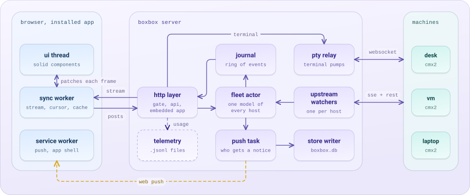

# boxbox docs

this page is for someone who has never seen the project. it says what the
pieces are, where they live and how one request travels through them. the
other docs go deep on one part each, and the index at the bottom points to
them.

boxbox is one place to control every agent. the server watches agents of any
kind, each through its own source, and the clients (the web app, the board
and a native ios app kept in its own repository) show their work and send
your verbs back. cmx2 coding agents are supported; openclaw assistants arrive
in m9, hermes in m10, and claude code and codex are planned. each new kind is
a source behind the seam in [agents.md](agents.md), so most of this page holds
for every kind; where it says daemon or host, it describes a cmx2 connection.

## the words

| word | meaning |
|---|---|
| cmx2 | a coding-agent runtime. one cmx2 daemon runs on each machine and hosts agent sessions |
| daemon, host | a running cmx2 process. boxbox calls each one a host and names it (`desk`, `vm`) |
| session, thread | one conversation with an agent. a thread's identity is `host:session` |
| turn | one prompt and everything the agent does until it stops |
| ask | a question or a permission request from an agent that waits for a person |
| needs | the list of asks and faults waiting for you, computed once on the server |
| window | home's card for a live thread, showing its latest work |
| seq, cursor | a counter on every event. a client that remembers its last seq can resume without gaps or repeats |
| journal | boxbox's own ring of recent changes, each already encoded once as the bytes every client stream gets (protocol 3, [protocol.md](protocol.md)) |
| the pin | the one cmx2 commit boxbox builds against, written in `cmx2.pin` |
| the board | an optional 17-key usb keyboard with a small daemon that talks to boxbox |
| agent, connection | from m9: someone you talk to (a cmx2 daemon, an openclaw assistant, a hermes agent), reached through a connection, one `boxbox.toml` entry ([agents.md](agents.md)) |
| pwa | a web app installed to the home screen, so it opens full screen like a native app |

## the pieces

<picture>
  <source media="(prefers-color-scheme: dark)" srcset="../assets/pieces-dark.svg">
  
</picture>

### `server/`, the rust crate `boxbox`

one binary, edition 2024, built with axum and tokio. `boxbox serve` runs the
server. `init`, `doctor`, `service` and `upgrade` are the command line that
installs and maintains it. each task owns its state and talks by message.

| directory | what it does |
|---|---|
| `src/source/` | the agent source seam: the `AgentSource` trait and `SourceEvent` union every kind of agent plugs into, the cmx2 source, thread ids, agent keys and identity, the send ledger |
| `src/upstream/` | the supervisor, one source per connection: a watcher per cmx2 host (holds the event stream open, resumes by cursor, backs off, reconciles after a reset), and an openclaw source per `[[openclaw]]` entry |
| `src/openclaw/` | the openclaw source ([openclaw.md](openclaw.md)): the gateway's protocol types, the device identity and pairing, the method allowlist every request passes, and one websocket per gateway with its request scheduler, event stream and reconnects. it connects and pairs today; its agents and threads come with its sync engine |
| `src/fleet/` | the fleet actor. folds every source's events into one model (threads, window tails, asks, needs, read state), runs each change through protocol 3's encoder (patches, 100 ms text batches, finished text once) and hands each stream what its interest shows |
| `src/journal.rs` | the ring of changes. each entry is encoded once and shared by every client stream |
| `src/http/` | the gate, the json api, the event stream and its interest posts, the thread reads, and the embedded web app |
| `src/auth.rs` | the password gate and its signed session cookie |
| `src/push/` | decides who gets a notification and delivers it with web push |
| `src/pty/` | relays a terminal websocket between the browser and a daemon |
| `src/store/` | the one writer of `boxbox.db`, a sqlite file for push keys and subscriptions, hosts paired from the app and their credentials, prefs, read marks, needs, cleared threads and adopted threads, foreign agents' keys and thread ids, and the sources' secrets (an openclaw gateway's device key and token) |
| `src/telemetry/` | validates and stores the app's usage events as one .jsonl file per day |
| `src/icons/` | finds a repo's favicon on its host and caches it |
| `src/cli/` | `init`, `doctor`, `service`, `upgrade` and the usage text |
| `build/` | build-time code generation. cmx2's types come from `vendor/cmx2/openapi.json` and openclaw's from `vendor/openclaw/protocol.schema.json`, so nothing is decoded by hand except openclaw's open transcript bodies, held to recorded fixtures |

### `app/`, the web app

typescript, solid and vite. the build output is embedded in the server
binary. a dedicated web worker owns the event stream and an indexeddb cache,
and posts small patches to the ui thread once a frame.

| directory | what it does |
|---|---|
| `src/sync/` | the worker: stream client, reducer, cursor, outbox for sends, indexeddb cache |
| `src/store.ts` | the one store the components read |
| `src/shell/` | routes, navigation, the app frame and gestures |
| `src/ui/home/`, `src/ui/window/` | home and its live windows |
| `src/ui/thread/` | the thread view: turns, rows, the stage |
| `src/ui/composer/` | writing a prompt, queueing, steering, starting a thread, model and effort pickers |
| `src/ui/assistant/` | the agent surfaces the neutral wire brings, standalone with their stories until the app's protocol 3 store feeds them: voice notes (record, play, peaks), pictures and files with the viewer, quotes, reactions, the reply strip, an assistant's window, card and picker (design.md, the agent surfaces on the web) |
| `src/ui/inbox/`, `asks/` | questions and permissions |
| `src/ui/machines/`, `settings/`, `term/`, `review/`, `history/` | machines and pairing, settings, the terminal pane, code review, past threads |
| `src/motion/` | the animation helpers. everything that moves goes through them |
| `src/push/` | the service worker and the notification code |
| `src/api/` | generated types for boxbox's api and cmx2's |
| `.ladle/` | stories: each part and state rendered on its own, for review and screenshots |

### everything else

| path | what it is |
|---|---|
| `vendor/cmx2/`, `cmx2.pin` | the pinned cmx2 commit and the two files copied from it, an openapi document and a manifest. `just check` proves they match the commit |
| `board/wire/` | the board channel's shapes, shared by the server and the daemon |
| `board/daemon/` | `boxbox-board`, the native board daemon |
| `board/trace/` | the harness that replays recorded key sessions against the daemon |
| `telemetry/` | the telemetry dictionary (`schema.ts`) and a query tool over the day files |
| `probes/` | scripts that test each cmx2 contract boxbox relies on against the pinned daemon |
| `bench/` | scripted drives with budgets: a fake model for the dev daemon, load and layout checks |
| `ops/` | the systemd unit, release builds and container tests |
| `scripts/` | dev tooling, `install.sh` and the repo's checks |

## one request, end to end

you type "run the tests" in a thread on your phone and press send.

1. **the composer** puts the text and a fresh `clientID` in the sync worker's
   outbox, which survives a reload, and shows the message faded.
2. **the worker** sends `POST /api/hosts/desk/sessions/<id>/prompt` over https. the request
   carries the session cookie from your sign-in.
3. **the http layer** checks the cookie against the gate, then forwards the
   prompt to the daemon named `desk` as `POST /session/<id>/prompt_async`,
   using the daemon's credential from `boxbox.toml` or `boxbox.db`. the credential never left the server.
4. **the cmx2 daemon** starts the turn. as the agent thinks, calls tools and
   writes text, the daemon emits numbered events on its event stream.
5. **the upstream watcher** for `desk` receives each event, drops any it has
   seen, and hands it to the fleet actor.
6. **the fleet actor** updates its model: the thread's state, its window tail, its needs.
   its encoder turns the change into a journal entry (a patch of what moved,
   or text batched over 100 ms), encoded once.
7. **the stream** to your phone sends that frame if your phone shows it: the
   overview goes to every stream, a thread's words only to the streams that
   have it open. the worker applies it to its
   cache and tells the ui thread what changed. the faded message becomes solid
   when the event carrying its `clientID` arrives, so a retry can never send it twice.
8. **the ui** renders the new rows. if the turn ends while the screen is off,
   the push task decides the "done" notice is worth sending and delivers it.

if the network drops between steps 6 and 7, the worker reconnects with its last
cursor and what the screen shows, and the server catches it up: the overview's
changes, then the open thread's words from where the worker left them, then
`caught` (`docs/protocol.md`, sections 5 and 9). if the cursor is from another
server run or too old, the
server sends a snapshot and the worker replaces its cache in one step.

## where to go next

| to learn | read |
|---|---|
| the full design, with memory and latency budgets | [architecture.md](architecture.md) |
| why each big choice was made | [decisions.md](decisions.md) |
| how the app looks and moves | [design.md](design.md), [home.md](home.md), [thread.md](thread.md), [composer.md](composer.md) |
| terminals | [terminal.md](terminal.md) |
| notifications | [push.md](push.md) |
| installing on a server, https, upgrades | [deploy.md](deploy.md) |
| what boxbox asks of cmx2 | [cmx2-asks.md](cmx2-asks.md) |
| agents beyond cmx2: the neutral wire, the agent source seam, what a source journals, the transcript cache, capabilities, the routes, media, sends that end uncertain, the runs window, identity | [agents.md](agents.md) |
| the device protocol (protocol 3) that replaced contract 1, its server built (the app, the board daemon and full resume on restart are not yet, `open.md`): interest, patches, catch-up, full resume on restart, paged thread reads, the summary, media references, the build packages | [protocol.md](protocol.md) |
| the openclaw connection: pairing, sync, the method allowlist, the test gateway, its mapping | [openclaw.md](openclaw.md) |
| how changes are verified | [verification.md](verification.md), [board-verification.md](board-verification.md) |
| known bugs | [open.md](open.md) |
| traps and the lessons behind them | [gotchas.md](gotchas.md), [scars.md](scars.md) |
| the build plan | [plan.md](plan.md) |
