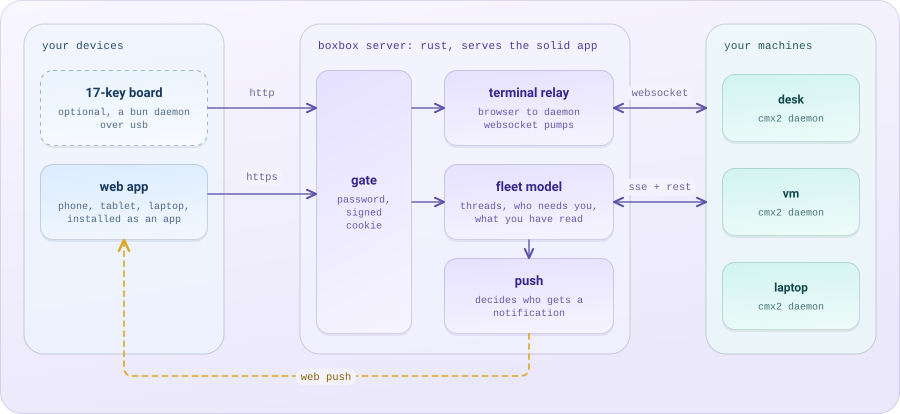
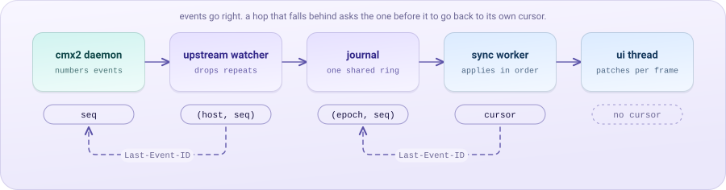

# architecture

how v2 is built and why. the bar is decision 13: the code is held to the
same standard as the screens, and memory and latency are design
parameters with numbers, not hopes. every number here has a gate in
`verification.md`.

## the shape

<p align="center">
<picture>
  <source media="(prefers-color-scheme: dark)" srcset="../assets/architecture-dark.svg">
  
</picture>
</p>

boxbox is one place to control every agent: a server that watches agents of
any kind and clients that show their work and send verbs back. each kind of
agent is a source behind one seam (`agents.md`, the agent source seam): cmx2
is supported, openclaw is being built in m9, hermes follows in m10, and
claude code and codex are planned. a new kind is a new source module and a
new `boxbox.toml` entry; the fleet, the journals and the clients do not
change for it, because clients render from capabilities (decision 30).

boxbox is one rust binary on the vm, with the solid web app embedded in it. it is reachable on the tailnet only and behind
a password gate. inside it, one supervised source task per connection feeds
the fleet actor (for cmx2, today's upstream watcher), which
feeds the journal and the client streams. push, read state, needs, presence,
the pty relay and telemetry all hang off that actor. the
static assets are embedded, state is one sqlite file, and telemetry is .jsonl.
[the pieces](README.md#the-pieces) draws the inside. the board is an optional
add-on: a keypad with a native daemon on the mac it is plugged into
(`boxbox-board`, decision 78), and its own channel in the server
(`docs/board.md`), not a client of the normal api. decision 1 holds what it
does to v1's behaviour. the native ios app is a third client,
kept in its own repository. agent credentials live on the server and
nowhere else.

why one server in the middle, not browsers talking to agents directly:

- **push needs a watcher that never sleeps.** only a server that holds
  every agent's stream can decide to buzz the phone while every screen is
  off.
- **agent credentials never reach a browser** (v1's rule, kept).
- **one seam for every kind.** a runtime's protocol stays inside its
  source, so the clients speak one wire however many kinds join.
- **one computation for every surface.** v1's drifting read state, faults
  and session lists came from each client deriving its own (`scars.md`:
  computed once). the server derives needs, order, read and window tails
  once, and phone, ipad, mac and board all render the same answer.

## the sync model: a cursor at every hop

the bug class v2 must make impossible is "the screen is stale until you
reload". v1 had no cursor anywhere, so every reconnect was a guess. v2
has a cursor at every hop, and each hop applies events exactly once, in
order.

<p align="center">
<picture>
  <source media="(prefers-color-scheme: dark)" srcset="../assets/cursor-dark.svg">
  
</picture>
</p>

1. **daemon to server.** each upstream watcher holds `(epoch, seq)` per
   host. the fleet keeps, per connection, the cursor whose effects its
   model holds and writes it to `boxbox.db` with them (full resume,
   below), so a restart resumes each host from that cursor with
   `compact=1` and no host read. within a run it resumes `/global/event` with `Last-Event-ID`
   (cmx2-asks a1) and drops any event at or below its high-water mark.
   it asks for cmx2's stream switches (`coalesce=100`, `types=` the kinds
   the source translates, `compact=1`, `gzip=1`, `rev=1`; `upstream/watcher.rs`),
   which an older daemon ignores; every request to a daemon takes gzip, and
   reqwest decodes an answer by its `Content-Encoding`, so a compressed
   and a plain answer read the same.
   cmx2 does not log deltas: a part that was streaming across the gap
   arrives once as a full `message.part.updated` at the resume seq, and
   live deltas continue after it. on `stream.reset` it reconciles from
   rest reads that carry `x-cmx2-seq` (a2) and applies only later events.
   that read is quiet: it journals only what moved (a gone thread
   removed, each thread whole, which the encoder drops when unchanged,
   gone asks settled), then a `thread.reset` only for a held thread whose
   `transcriptRev` moved or that has none to judge by; a thread whose
   revision held still but that was busy across the gap gets its newest
   messages read and journaled whole instead, and the tails of those
   threads are read again (`protocol.md`, section 10, the quiet
   re-read). each thread's `srev` comes only from events the fleet
   journaled, session infos it applied, and reads it folded in itself
   whose seq the stream had reached. no merge heuristics exist anywhere.
2. **server to browser.** the fleet actor runs each change the model
   makes through one encoder (`fleet/encode.rs`: thread and order
   patches, text deltas in 100 ms batches, finished text once) and
   appends what it gives to the **journal**, a ring with its own
   `(epoch, seq)`. a client stream is protocol 3 (`protocol.md`):
   `GET /api/stream` with `Last-Event-ID` and its interest (the open
   thread, the layers under it, the children it holds). overview entries
   reach every stream, transcript entries only the streams whose interest
   holds their thread (so a stream's ids skip seqs, and a skipped seq is
   never a gap), and `POST /api/stream/{stream}/interest` moves the
   interest with an in-band confirm (section 5). a resume is one compact
   catch-up from the cursor (each key that moved once, whole; tombstones;
   per interest key its compacted transcript or `thread.stale`; then
   `caught`; `fleet/catchup.rs`, `fleet/keys.rs`), never a replay of
   the ring. no cursor, a cursor from another epoch (the server's kept
   state was lost or failed its check at start) or one below the
   tombstone floor gets `reset` with the journaled fleet instead.
   **full resume** (`fleet/persist.rs`, `protocol.md` section 10): the
   actor marks each key dirty as it journals it or a source moves its
   model state, and every second takes one batch (the dirty rows, new
   tombstones, head, reserved mark, every cursor) to its own writer;
   marks clear only on the writer's `ok`, one batch in flight. a batch
   unanswered for 10 s, a dirty set past 16 MiB or a head near the
   reserved mark stops source intake until the answer (backpressure on
   the daemons). a clean stop writes `clean = 1` inside 5 s and the next
   start keeps the epoch and head, so a connected device's catch-up is
   empty; a crash starts at the reserved mark with every key whole once
   and every thread's versions there. every frame ready when the socket takes bytes
   goes out in one write (up to 64 kb), and a client that sends
   `Accept-Encoding: gzip` gets the stream through its own gzip context,
   sync-flushed after each write so nothing waits to decode
   (`http/compress.rs`, `Framed`; the board stream does the same).
3. **worker to ui.** the worker applies events to its indexeddb cache and
   posts **patches** to the ui thread, coalesced to one message per
   animation frame. the ui never parses the stream and never talks to
   indexeddb. a patch costs what changed: a thread the server patches
   (`thread.patch`) or sends whole again is compared with the one held
   and patched leaf by leaf
   (an array item that changed goes whole, so nothing the ui holds
   changes under it), and a delta posts only the words it adds, as an
   append the ui joins to the text it holds. the ui's store holds only the
   threads it shows (the stage, the layers under it, and the children their
   lanes hold; a child a lane lets go of leaves once it was read, and its
   layer keeps the numbers its row, the details and the spend read of it,
   `ui/thread/live.ts`, `kept`; `showThread` and `hideThread` in
   `app/src/sync/client.ts`): the worker
   posts a thread's patches only while it is shown, the thread as it holds it
   when it is shown again, and a delete when it is not, with which the ui
   drops the thread's turn models and keeps its measured heights. a mouse or
   pen press on a thread's window shows it ahead of the click
   (`pressThread`): one thread at a time, let go when its open holds it, at
   the next press, or 1.5 s later with no open, and a press no open followed
   leaves the worker's order of the closed as it was. the copy-back (and a
   cooled thread's restore) then lands before the click mounts the stage. while the
   page is hidden the worker posts nothing: it holds the patches, coalesced
   as they come, and the stream's last status, and posts them as one message
   (the status after the patches) when the page is shown, which the ui lands
   in one go
   (`app/src/sync/gate.ts`, `landing.ts`), so the caught-up second never
   runs out with the store behind the replay (`ui/caught-up.ts`; the wire
   replay times it, and fails the hidden queue that was reverted for racing
   it). a reset diffs the snapshot against the fleet held, so a thread it
   sends as it was keeps its identity in the ui. what the ui shows is also
   what the stream's interest names: the worker takes the stage from
   `open` (and, when the stage closes over a layer, the layer opened last
   becomes the stage, as `docs/protocol.md` section 5 says), the layers under it from the threads the person opened that the
   ui still shows (bottom first, the nearest 8; a thread a press shows is
   no layer until its click opens it, so a press posts no interest), and the holds from `hold`
   until `release` (the first 16), and the reducer posts the interest
   (`POST /api/stream/{stream}/interest`) when it changes, once a turn:
   each page message is its own worker task, so a change marks a post due
   and a `setTimeout(0)` posts the interest as it stands after the
   messages queued with it (an open with five agent children posts once,
   where it posted six times), and nothing when the server has it or will
   once the newest post out applies. the change goes before the open, hold
   or show that would read a thread entering it; a read of an entering
   thread waits for the in-band confirm, so it lines up with the stream. a post the server cannot take (404: the stream ended; any other
   failure) is never posted again: the worker dials again with the interest
   in the query. a page hidden for 30 s asks for the overview only, and
   asks for what it shows again, with each thread's `left`, when it is
   shown; `pagehide` closes the stream and `pageshow` dials again.

**cold launch** reads the cache (fleet model plus the open thread's pages)
and paints on the first frame, then the worker resumes the stream from the
cached cursor. anything replayed paints without motion (`design.md`).

**liveness.** the server writes a comment heartbeat every 15 s; every
reader (worker, board, upstream watcher) aborts after 45 s without a byte
and resumes. a half-open socket is found in under a minute, and resuming
costs nothing because of the cursor (`scars.md`: sse established but dead).

**transcripts.** the journal carries every event, but the worker keeps
transcripts only for threads it has pages for (opened by the person, held
for another thread, or cached; see the indexeddb layout). opening a thread reads it under
`/api/agents/{agent}/threads/{thread}/messages` (`http/agents/read.rs`):
the source's answer (cmx2's `GET /session/:id/message`, with the
in-flight message, a5) translated message by message as it streams,
stamped `x-boxbox-seq` (the journal head when the read began) and
`x-boxbox-upstream` (the source event it reflects); the client applies
journal entries after it. its etag comes from the thread's versions
(`Fleet::versions`: `v`, `rv`), so a revalidation of an unchanged thread
is a 304 without the source (`protocol.md`, section 11). a thread that
entered the interest at seq H takes a read only from H on, else it is read
again and `sync.fault` says `read-late`; H keeps its epoch, and a read
stamped with another one, answered by a restarted server between a drop and
the next hello, is shown but never weighed against H and leaves `left` as it
was, so the next connect's reset reads it again. the worker sends `If-None-Match` by hand (its reads
are `cache: "no-store"`) only when the thread's head holds an etag, and a 304
stands as the read: the messages it holds, with the answer's stamps. without
an etag every read is whole. parts are keyed by the daemon's ids: a `part`
entry (cmx2's `message.part.updated`) replaces a part whole, a `delta`
appends at its `offset` (a1), `message.removed` deletes. a settled text
part may come with `textOf` instead of its words (`docs/protocol.md`,
section 8): when the hash and length match the words the thread holds it
keeps them, and when they do not, or the part is not held, it fetches the
message again and `sync.fault` says `hash-miss`. the entries of a
`catchup` frame apply by the same rules but never move the cursor, and
pass the upstream gate against the read alone: the server compacts a
message to its last info ahead of its parts, so their upstream seqs come
out of order (section 9). deltas in boxbox's own journal replay to a
browser exactly once by journal seq; the offset check catches any gap and
turns it into a refetch of that one message. a delta at offset 0 for a part
the thread does not hold is that part's birth and creates it, so a reply
streams from its first delta. a message's parts are held in the daemon's
order (cmx2's part ids are `prt_<session>_<seq>_<index>`; the thread places
a new part by those numbers, and ids of another shape keep arrival order),
whatever order the stream delivers them in. a refetched message is merged,
not replaced: the snapshot's parts replace held ones with the same id
(never shortening text), parts it lacks stay, and every entry that arrived
meanwhile applies over it in order. the worker puts a cached thread's parts
in order as it reads its pages back, before the thread is posted. the client
never guesses where a turn goes, so a turn cannot settle out of order,
vanish or double.

**sends.** every send carries a `clientID` (a4). the composer shows it
faded until the event carrying that `clientID` arrives; a retry after a
timeout reuses the same `clientID`, so a flaky network cannot double a
prompt or an answer.

## the backend

**stack:** rust, tokio, axum (http, sse, websocket), reqwest with a
hand-written sse reader (a bounded line buffer and a byte-level stall
timer), serde, `rusqlite` on one writer thread, `web-push-native`, `tracing`,
`rust-embed` for the ui. types for cmx2 are generated at build time from
cmx2's `openapi.json` (the `Event` union is a discriminated `oneOf` on
`type`), so no decoder is written by hand. boxbox's own api is described
with `utoipa` and its openapi document generates the typescript client.

**tasks, and who owns what.** state has exactly one owner and moves by
message, never by shared locks on the hot path:

| task | owns | talks to |
|---|---|---|
| upstream watcher, one per host | the host's connection, `(epoch, seq)`, backoff | sends decoded events to the fleet actor |
| fleet actor | the fleet model: hosts, sessions index, window tails, asks, needs, read, the board's projection while a board listens, presence; protocol 3's encoder (patch bases, pending deltas, settled-text tracking), the stream keys (`fleet/keys.rs`: per key its newest seq and versions, tombstones) and the stream map (per stream its id, interest, owner and last confirmed ask) | appends to the journal, hands each stream its entries and confirm blocks, asks push to decide |
| journal | the ring of encoded entries and its `(epoch, seq)` | answers a since key's transcript for a catch-up |
| client stream, one per connection | a bounded outbound channel and the confirm block it is draining | writes sse; ends its map entry when it drops |
| push | subscriptions, presence, pending "done" timers, per-device rate and dedupe | sqlite, the web push services |
| store writer | `boxbox.db` | everyone, through a channel |
| telemetry | the day's .jsonl file | appends in batches |
| pty relay, one per terminal | two bounded websocket pumps | the browser and cmx2 |
| icons task | the repo-icon cache (256 entries, 8 mb), the lookups in flight, three per-host memories (project list, host cannot read files, home) | spawns a lookup task per `(host, root)`; reads the fleet for the places a host has shown; one `find/file` and `/file/content` conversation per daemon |
| agent source, one per connection (m9) | the connection (a cmx2 daemon's watcher, an openclaw or hermes gateway's socket), its cursors, its id maps, its in-memory seen index, its reader channel and request queue, and for a socket source its transcript cache file (`<data dir>/cache/<connection>.db`, written on its own blocking thread) | sends `SourceEvent`s to the fleet actor; answers verbs through the `AgentSource` trait (`agents.md`, the seam). the upstream watcher above becomes the cmx2 source's run loop |
| media task (m9) | the media store under the data dir and its index rows: uploads (and their buffers), copies of agents' media, eviction | the store writer; the sources, for copies; `GET /api/media/{id}` reads files by id (`agents.md`, media) |

**the fleet model** is the single source for every surface: the sessions
index (identity is `host:session`, repos never merge across hosts), each
session's state, queue, parked detail, subagent and process counts, and its
**window tail** (the last 12 display items in the grammar `design.md`
defines: folded reads, edits with counts, commands with results, the last
two sentences of prose). a tail streams from the events, and the first
time the fleet learns of a session that gets a window (working, wanting
you, a need open, or touched in the last 12 hours; never a subagent) it
also reads the session's newest 12 messages once through the upstream
(`GET /session/:id/message?limit=12`, with `x-cmx2-seq`; the last 3 when
those pass 4 mb), so a thread idle since before boxbox started shows what
it last did. the reads go through one task beside the watchers
(`upstream/tails.rs`), at most 3 open per host. the tail becomes the read
at its seq R; the tail changes that came while it was out are kept (at
most 24, a part's later versions and its contiguous deltas each one
change) and replayed on top when newer than R, and afterwards a sequenced
transcript event at or below R leaves the tail alone, so each event
applies once. a read overtaken by more than that is taken again, three
times at most. a session first seen being born is never read; a failed
read is taken again when its host is next read, never per event; a host
read in another epoch reads every tail again. the window order (the
inbox) is computed here, once. the snapshot of the whole model stays
under 256 kb for 300 sessions; the journal carries changes to it as small
typed events.

**memory is a design parameter.** every buffer has a byte cap and an
owner; every map has an eviction rule. the caps:

| thing | cap | on overflow |
|---|---|---|
| journal ring | 16 mb or 100,000 entries, one ring and one epoch (`journal.rs`) | oldest entries fall out; a since key whose entries are gone gets `thread.stale` (`protocol.md`, section 9) |
| model caps | order 300, sessions 1000, adopted 20, clears 2000, needs 500 open and 200 served, over every source's threads together | each evicts by its rule |
| stream map (`fleet/mod.rs`, `Subscriber`) | one entry per open stream: its id, an interest of 1 thread, 8 layers and 16 holds, its owner (a hash of the session token) and last confirmed ask | removed when the stream ends, falls behind, stalls on a confirm or fails a send; a post past the interest caps answers 400 |
| confirm block (`fleet/catchup.rs`) | 1 mb of catch-up frames (each at most 256 kb) per stream, one in flight, outside the 512 kb outbound cap, drained through the stream's `pending` | a key past it goes `thread.stale`; a post meeting an unread block waits for it to drain, until the block is 30 s old (counted from when it was handed to the stream), then the stream is closed and the post answers 404; a block drained by then closes nothing |
| tombstones (`fleet/keys.rs`) | 10,000 rows or 7 days of removals and settlements | oldest dropped, the floor rises; a cursor below it gets `reset` with reason `expired` |
| patch bases (`fleet/encode.rs`) | one `Thread` per kept thread (at most 1000), plus the order | evicted with the session |
| pending deltas (`fleet/encode.rs`) | 100 ms per part or btw, 1 mb in all | past it, all are journaled at once |
| btw answer counts (`fleet/encode.rs`, `TRACKED_BTWS`) | the utf-16 length of each running btw's answer, 1,024 btws (8 kb) | oldest dropped; its next deltas go without an offset and the client rereads the thread's btws (`protocol.md`, section 8, btws) |
| btws in the worker (`app/src/sync/btw.ts`) | 64 per thread, inside the thread's byte cap, one `#btw` record each | oldest settled first, then oldest running |
| settled-text tracking and remembered digests (`fleet/encode.rs`) | 4,096 streaming parts (length and hash of their built text), each dropped once a part with `time.end` is journaled; 4,096 parts and 4,096 messages (a digest of the last state journaled, which still drops the step-end re-send) | oldest dropped; a dropped part's next update goes whole, a forgotten digest lets one unchanged re-send through |
| newest-turn message ids (`fleet/keys.rs`, for `rv`) | 1,000 per thread and 16,384 over every thread (`TURN_IDS`, `ALL_TURN_IDS`): about 1.3 mb at the cap, counting some 80 bytes an id with its set's overhead | past either, every entry of the thread whose set would grow counts toward `rv` until its next turn starts; a removed thread or a reset frees its ids |
| client outbound channel | 512 kb of plain frames queued in the actor for one stream; what the stream already handed on is on top: hyper's write buffer (16 writes or about 408 kb, each write at most 64 kb of frames before compression) and the kernel's socket buffers, compressed bytes for a client that takes gzip. measured once with a client that never reads (`http/stream.rs`, `a_stalled_client_holds_a_bounded_amount_with_gzip_and_without`, loopback on a mac): 155 kb handed on with gzip (4.3 mb of frames), 1.6 mb without | the stream is closed; the client resumes from its cursor. a slow phone can never grow the server past these |
| client stream gzip context, one per connection that takes gzip (`http/compress.rs`, `GzipStreams`) | about 300 kb (the 32 kb window and deflate's state), for the connection's life; at most 64 such streams at once, the board view's among them | past 64 a new stream is identity, and one warning says the cap was met (said again only after a place frees and the cap is met anew) |
| upstream sse line buffer | 8 mb per frame (a tool part's 4 mb of image attachments, whole) | the frame is logged and skipped, the stream survives |
| thread reads and pages (`/api/agents/.../messages`, `source/cmx2/verbs/read.rs`, `http/agents/page.rs`) | one message at a time, at most 32 mb; a page holds its turns, at most 64 or, past the first, 1 mb of json, each message once and one turn at most 64 mb; a body silent for 45 s ends the read | a message past 32 mb fails the read (502); a page drops its oldest turns, and one that would hold a turn past 64 mb answers 413 |
| thread summaries (`fleet/summary.rs`) | 64 threads or 8 mb of json; children's numbers apart, 1,024 or 1 mb; one computation per key at a time, at most one per thread per 10 s while `rv` holds; 64 children read per summary, 4 at once, 10 s each, 15 s in all; failed children remembered 30 s, 1,024 at most | least recently used first; a child past the count or late is listed by key |
| worker cache (indexeddb) and the threads in its memory | 40 opened threads, 16 held-only threads beside them, and 50 mb for both, by the size of each thread's json (a read's body, then every change applied) | the count caps evict their own kind, longest unused first; the byte cap evicts held-only threads first, then opened ones longest ago first, never the thread on stage or the one the open or read is for (the indexeddb layout, above) |
| worker sse frame buffer (`app/src/sync/sse.ts`) | 32 mb of text for one frame, four times the largest the server forwards | the connection is dropped, `perf.sync` says `overflow`, and the stream resumes from the cursor with a growing backoff |
| worker saves | one committing and one waiting, whatever the disk's speed | a save asked for while one commits joins the one waiting |
| worker entries waiting on a read: a hydration's buffer, and what waits for a message fetched again | the buffer 20,000 entries or 128 mb, what waits for refetches 128 mb per thread (each sixteen frames at the server's 8 mb frame cap), by the size of each entry's words (a part as the thread counts it) | the thread is read again whole, which covers everything that waited |
| pty relay | 256 kb each way | the socket is closed; the relay redials with the cursor |
| media store (m9) | `[media] max_bytes`, 2 GiB unless set; 64 MiB a file; 4 uploads at once, 1 MiB buffered each, owned by the media task; 2 copies per connection in flight and 64 queued, 1 MiB buffered each, queued by the source and written by the media task (`agents.md`, buffers and caps) | least recently used first, never pinned media or media under 24 hours old; an evicted id answers 410 (`agents.md`, media). a fifth upload answers 503; a full copy queue defers the copy, never marks it missing |
| socket source buffers (m9, per openclaw or hermes connection) | reader channel 4096 frames or 16 mb; seen index 200 rows of 24 bytes for 2,000 threads (9.2 mb); live text 8 runs of 256 kb; 256 events per session held during its first read; 10,000 thread ids; 256 sends being reconciled; requests 4 in flight and 8 queued (`agents.md`, buffers and caps) | the reader sheds at half and stops reading when full; the seen index and id map evict least recently used; a verb past the request queue answers 503 `agent-busy` |
| transcript cache (m9) | `[cache] transcript_bytes` on disk, 256 MiB unless set, split between socket connections; per thread 200 rows or 2 MiB, threads active or opened in 30 days; 2 mb of sqlite page cache per connection in memory | least recently opened threads go first; a deleted file refills by use (`agents.md`, the transcript cache) |
| window tails | 12 items per session, 300 sessions with windows | older items drop; sessions without a window keep no tail |
| window tail reads | one per session with a window; 3 open per host, 512 queued, 4 mb a body; 24 tail changes kept while one is out | a full queue leaves the session to ask on its next change; a larger body is read again as the last 3 messages; more changes drop the read and take it again, three times at most |
| repo icons | 256 entries and 8 mb of icon bytes (an icon is at most 512 kb); 64 lookups in flight, 4 talking to daemons; 256 requests queued; 64 hosts in each per-host memory | expired entries go first, then the least recently used; a lookup past a bound is answered `retry` at once and nothing queues |
| telemetry batch | 1,000 events or 500 ms | flushed |
| page telemetry rows (`app/src/sync/telemetry.ts`, the worker's queue and outbox rows; `client.ts`, the page's `unsent` copies) | 500 rows each (`QUEUE_CAP`), one constant in `sync/queue-cap.ts`, what the server takes in one batch | the oldest row is dropped from the queue and the outbox, and the worker tells the page (`dropped`) so it lets its copy go; the page also drops its oldest copy past 500. a dropped row is never sent nor counted as sent |
| telemetry recent ids | 4,096 ids (under 400 kb) | the oldest id is forgotten; a repeat older than that is written twice, which the query tool tolerates |
| message photos in flight | 100 mb of memory: two messages at the body limit (25 mb), each counted twice (the bytes read, then the strings parsed from them), taken from the announced size before a byte is read; a body over 25 mb is refused as it passes the limit (413) | a message waits up to 2 minutes for room, holding nothing, then is answered 503 `photos-busy`; words (under 256 kb) never wait. measured in `composer.md`: linux returns to idle (9 mb) after every burst |
| process | steady rss 64 mb for 3 hosts and 300 sessions (a message with photos is a peak on top of it, bounded by the row above, for the seconds it is in flight); from m9, 80 mb steady for 3 cmx2 connections, 1 openclaw connection and 300 windows, and 211 mb at peak (the arithmetic below); systemd `MemoryMax=256M` as the backstop, never the plan | the soak test fails the build |

**the m9 arithmetic.** the plan budgeted 8 mb for a contract 1 ring and
4 mb for a second copy of each cmx2 thread; protocol 3 built neither
(`protocol.md`, section 15), and spends that 12 mb on its own state
instead: the patch bases (one `Thread` per kept thread, about 1 mb for
1000 against the snapshot's 256 kb for 300), the stream keys' agent and
ask bodies and tombstones (10,000 rows of a few hundred bytes, about
3 mb), the encoder's tracking and digests (under 1 mb), the newest-turn
id sets (16,384 ids over every thread, about 1.3 mb at that cap), pending
deltas (1 mb at most) and a confirm block per stream catching up (1 mb
each, one in flight). steady is still today's 64 mb, plus those 12 mb, plus 4
mb per socket connection in steady use (its id map of 10,000 rows, 2 mb
of cache pages, a seen index far below its cap): 80 mb with one
openclaw connection. peak, every bound full at once: a
socket connection's buffers add 27 mb over its steady share (16 mb
reader, 9.2 mb seen index, 2 mb live text, 2 mb copy buffers, 1 mb held
events, less the 4 mb already counted), uploads add 4 mb, and a message
with photos adds the 100 mb of its row: 80 + 27 + 4 + 100 = 211 mb with
one openclaw connection, 238 mb with two, both under the backstop. the m9
gate measures idle, steady and this peak; a third socket connection is
past the backstop's margin and needs the backstop raised by 32 mb a
connection in the same change.

the v1 balloon is impossible by construction: resyncs are bounded (a1,
a2), a host read journals only what moved and one `thread.reset` per
thread it held, never a whole snapshot per scope, streams can't queue
without bound, and nothing is serialized once per listener (events are
serialized once, into the journal, and shared by reference).

**repo icons** (`server/src/icons/`, `http/repo_icon.rs`). `GET
/api/hosts/{host}/repo-icon?root=<project root>` answers 200 with the
image or 404 with an empty body: the app relies on nothing else, and
`x-repo-icon` (hit, none, unproven, unsupported, refused, retry) is for a person
debugging. one task owns the state and moves it by message: requests come
in on a bounded channel (256; a full channel answers `retry` at once), a
lookup that needs a daemon runs as a task of its own (4 at a time, 64
distinct in flight, 60 s each; concurrent asks for one `(host, root)` join
it) and reports back by message. discovery reads before it lists, because
the pinned daemon lists with a synchronous ripgrep on its event loop (cmx2
ask a29): 15 well-known paths (`favicon.*` at the root, in `public/` and
`static/`, `app/favicon.ico`, `app/icon.*`, `src/app/...`) and the root
app's Next.js prerender are read first, and only when every one is missing
or empty is the directory listed, with two `find/file` queries
(`favicon`, then `icon.`; both, because the first may find a broken file),
ranked (name, depth, extension; vendored paths
and a bare `icon.*` outside `app`, `public`, `static`, `assets` dropped),
the best three read through `/file/content` and the first that sniffs as
an image wins (png, jpeg, gif, webp, avif, ico, svg root; 512 kb); with no
static file, a Next.js `app/icon.tsx` in a package is answered by its build's
`.next/server/app/icon.body`, never by running the module. nothing is sent
to a host for a root it has not shown: the root must be a session's
project root or directory in the fleet, or a project the host lists; and
a root that is the host user's home or above it (`/` is a 400) is
`refused` and never listed.

| ending | server keeps | client `cache-control` |
|---|---|---|
| hit | 6 h | `private, max-age=21600`, with an `etag` (304 on a match) |
| barren: searched, none | 30 min | `private, max-age=1800` |
| unproven root | nothing | `private, max-age=60` |
| unsupported: the daemon has no file route (a28) | per host, 5 min | `private, max-age=300` |
| refused: the host's home, or a directory above it (a29) | the host's home, 1 h | `private, max-age=3600` |
| retry: an error, a timeout, an empty answer where there must be one | 15 s | `no-store` |

only "searched, and there is none" is a verdict about a repo. a missing
route is a fact about a daemon, remembered for the host so a page of repos
costs no call and forgotten fast enough that the first daemon that learns
the route shows icons within minutes (a 404 counts as a missing route
unless it is named `FileNotFoundError`). the cache evicts entries past
their time first, then the least recently used, until it holds both bounds;
only an icon's bytes count toward the 8 mb. every answer of the route, the 400, the unknown host and the sign-in
refusal included (a layer on the route, outside its sign-in check), carries
`x-content-type-options: nosniff` and `content-security-policy:
default-src 'none'; style-src 'unsafe-inline'; sandbox`, since an svg is a
document.
one `info` line per finished lookup (the first asker's request id, host,
repo name, a root hash, the class, the reason when it was a retry, daemon calls, how many asks waited,
latency); a cache answer logs at `debug`.

**shutdown** drains: stop accepting, send a final heartbeat, close every
stream and relay, flush telemetry and the store, exit inside 5 s
(`scars.md`: sigterm hang).

**errors.** typed with `thiserror`, mapped once to http. no `unwrap` or
`expect` outside tests. every upstream failure is logged with host,
route, status and latency in one structured line.

**needs and read state** are the fleet model's (`fleet/needs.rs`,
`fleet/read.rs`). the model keeps no clock: the actor gives it the time
before each input and drains its effects after: needs raised and served
go to telemetry (`need.raised`, `need.served`, `need.cleared`) and to
`boxbox.db` through one writer task; notices go to push; read marks go
to the store. each thread carries its open needs and its merged read
mark (sent as `thread.patch` fields when they move), so the stream and
every surface render the same answer with no new frame type. `GET /api/needs` answers the ledger with `x-boxbox-seq`,
the journal position it reflects. the ledger holds at most 500 open needs
(the oldest news expires first, never an ask) and 200 served ones; a
session keeps at most 16 device marks. presence reaches the fleet from
push over a watch channel (who is looking, and until when), so the fleet
never keeps a second copy of it.

## the frontend

**stack: typescript (strict), solid, vite. a static single-page app, no
ssr, no framework server.** the ui is embedded in the rust binary and
served as hashed files plus one `index.html`.

why solid:

- **fine-grained updates.** a streamed word updates one text node; a
  rolling counter updates one span. nothing re-renders a tree to find
  what changed, which is the exact cost v1's 5,500-line store fought with
  memo discipline and lost (`scars.md`: the perf layer).
- **stores that take patches.** the worker sends path patches; solid's
  store applies them with structural sharing and wakes only the
  components that read those paths. a reading over the whole fleet keeps
  that promise only if it reads each session in a memo of its own
  (`ui/fleet-index.ts`): `Object.values(state.fleet.threads)` in one memo
  reads every thread, so any frame re-ran it over all of them. home's
  window list, host count, views and streaming label and the stage's
  agents and kin are built that way, and cost the thread a frame names.
  the screens' one second clocks (`ui/clock.ts`) stop while the page is
  hidden, ticking only to reach a moment logic named (home's 12 hours,
  the composer's offline word), and come back on the tick a clock that
  never stopped would show.
- **idle is a budget.** with a fleet streaming and nobody touching it,
  the page's main thread, the sync worker and the heap each have a
  target (`design.md`, buttery as numbers: what the app costs while
  nobody touches it), gated by `bench/idle.ts` (`verification.md`, the
  idle run) and watched in the field by `perf.sync`, the worker's minute
  of frames, patches posted and indexeddb bytes put.
- **small**: the framework is about 7 kb. the whole app's first load
  budget is 120 kb of script, compressed, and `index.html` has 12 kb of its
  own, compressed (it carries the providers' marks as an inline sprite);
  `scripts/compress.ts` gates both. the first load is what a cold launch
  paints (the gate, home, a thread on its stage, the composer), as one
  chunk; the rest are chunks loaded when asked for: by route (machines,
  history, settings, the terminal and its screen), and by need (the review
  card, the highlight engine, what follows a copy, a photo's clamping), by
  what runs only after the server answers (notifications, this device's
  prefs, presence, the perf emitter: each a chunk read from the worker's
  precache as it starts), and warmed when the page is idle after the
  launch: the surfaces that open at a press (`app/src/ui/later.ts`: the
  new-thread sheet, home's answer sheet, the model menu, the effort dial,
  the plus menu's rows, the composer's suggestions, the queue's list and
  its verbs, a report's sheet, the file reader, the spend dialog, a
  picture full size), which open through `whenLoaded` so none opens onto
  nothing, an opened row's file bed, script bed and slip (`thread/code.tsx`, drawn
  only in a row someone opened), an opened agent's, search's, plan's,
  files, edit's or thought row's body (`thread/bodies.tsx`), a settled
  question's record and a settled permission's line
  (`asks/ask-record.tsx`; a pending ask's card stays in the first load),
  the model menu's stars, the moves that
  land a press on a row in a closed group (`thread/land.ts`, read at the
  press), and the stage card's edge in motion
  (`home/edge.ts`), which runs only at a fold and starts in the fold's own
  task once warmed.

what it beat: react (virtual dom diffing on every delta, and v1's scar
history), svelte 5 (a close second with similar fine-grained runes; solid
wins on its store and reconcile primitives for patch-driven state), no
framework (the prototype is vanilla, and a hand-rolled reactive layer at
app scale is the kind of thing decision 13 rules out).

**the sync worker** (a dedicated web worker) owns the stream, the
cursor, the reducer and indexeddb. it reads the stream with `fetch` and a
`ReadableStream` reader rather than `EventSource`, so it controls
`Last-Event-ID`, the byte-level stall timer and backoff itself. json
parsing and storage writes never touch the ui thread, so scrolling and
typing stay smooth while a busy fleet streams. the stall timer is one
timer that reads the time of the last byte when it fires, not a timer
set again per chunk, and the parser holds at most 32 mb of text for one
frame (four times the largest the server forwards): past it the
connection is dropped, a `perf.sync` row says so, and the stream resumes
from the cursor, backing off as a dial that never went live does, since
the server sends the same frame again. saves are 200 ms after the first change (1 s while a part
streams) and one at a
time: what changes while a save commits waits for the next, which writes
all of it from the state as it is then, so a slow disk (a mac with its
display asleep) costs fewer, larger writes and never a queue of them. a
save writes what the patches named and no more, and reads the meta in
its own transaction first: when another writer (a second tab, or a page
reloading over the last save of the one before) wrote since, it writes
the fleet and the threads it names whole, since its memory of the disk
is stale. from then until it writes a thread whole, a cold thread's head
is written from the head on disk (its pages are the other writer's, so the
head keeps their count and is marked stale), and its pages are never read
by the count in memory: opening it reads it from the daemon. a read of
pages while the meta names a save this tab has not seen is refused the same
way. the cursor is put last, and a save that throws part way is
aborted. once a minute while the
stream is up, `perf.sync` counts what the connection cost: frames,
bytes received, seqs the stream skipped (from its ids), patches posted and
about their bytes, saves, records put and about their bytes, with the view
(home, thread, hidden). each connection's opening is a `sync.catchup` row
(caught or reset, frames, bytes, stale and reset threads, the time to it),
each confirm of an interest post a `sync.interest` row, and each rule that
caught something (`patch-error`, `catchup-error`, `read-late`,
`hash-miss`) a `sync.fault` row.

**the reducer** is one exhaustive function over the journal's event
union, generated from the server's types; the typescript compiler fails
the build if a new event kind is not handled (`scars.md`:
`message.removed` must be handled). it checks a whole frame before it
applies any of it: a frame that cannot apply to what it holds (a patch for
a thread it does not have, an order op out of range: `docs/protocol.md`,
section 3) applies nothing, says `sync.fault` `patch-error` (`catchup-error`
for a catch-up), drops the
cursor and dials again, so the next connection starts with a reset. it is
pure and tested with recorded journals and the protocol 3 wire replay
(`verification.md`, the protocol 3 client).

**indexeddb layout** (v6): `meta` (cursor, epoch, build id), `fleet` (the
model as a record per thread, ask and agent, one per other field, and an
index of the fields and of each map's keys in order, so a thread that
changes writes that thread alone and the fleet read back keeps its key
order), `thread:<agent:thread>` a head (with the thread's `left` and
`etag` when it has them), its btws whole in `<agent:thread>#btw`
(`protocol.md`, section 8, btws), a baseline, pages and chunks:
the last message, the one a stream grows, alone in the last page, before
it pages of 50, and what is left in pages of 32, 16, 8, 4, 2 and 1, so a
change to a message rewrites that message and a new message rewrites a few
small pages, never the fifty before it (`app/src/sync/cache.ts`, `layout`;
pages written as 50 to the end before v4 read as they are). text that only
grew at its end (the reducer's appends) rewrites nothing: each save puts
the words added since the last one in a chunk record (message, part,
field, the length it starts from, the words), a read folds the chunks into
their messages, and the first save that writes any page of the thread (the
part settling, the next message joining), would pass 1,024 chunks, or
would leave the chunks holding more words than the texts they grow held on
their pages (64 kb at least) folds them into their pages and drops them.
each fold at least doubles the words the next one waits for, so a
streaming answer stores about two to three times what it streamed however
long it runs (a 10 minute answer of 4.4 mb wrote 31 mb when chunks folded
every 256 saves, and writes 9.3 mb), not its length at every save or every
fold. while a part streams the worker saves once a second instead of every
200 ms (the cursor goes with each save, so a reload replays at most a
second more from it). the head is written with
every save of its thread and so holds no baseline (a number per part,
which grows with the thread): the baseline has its own record, written
when it changes. v6 is protocol 3's: the upgrade from any earlier version
clears `fleet`, `threads` and the meta's cursor (contract 1 and cmx2
shapes), so the first connect gets a reset and each thread reads its newest
page when it is next opened, and keeps the stores below; a build before v6
fails to open the newer database and runs without its cache. `media` (image
bytes, empty until a later build fills it), `drafts` (a target's words) and `draftPhotos` (its photos, written only when the set changes), `outbox` (sends not yet echoed by client id, telemetry rows under `row:`, and this device's replies to asks under `ask:`, at most 200, the oldest dropped first: `app/src/sync/replies.ts`), `prefs`.

**what the cache keeps and lets go.** a thread is *opened* (the person
opened it: `openedAt` is the time) or only *held* for another thread (a
child's lane under its parent on stage: `openedAt` 0, `heldAt` the time it
was last held). a hold is a worker `hold`, not an `open`: it reads the thread
the same way, but it never refreshes an opened thread's recency and it keeps
a reserve of places of its own, so it never costs an opened thread a place. a
held thread the person then opens is promoted in place. the caps, counted over
threads in memory and cold together:

| set | cap | evicted first |
|---|---|---|
| opened threads | 40 | the one opened longest ago |
| held-only threads | 16, beside the opened ones, each place a lease | a lease lasts while the thread is held and not released, however old it is. with all 16 leased a new hold is refused: nothing is read and no other lease is touched, so a lane that wants more than the reserve (several stages at once) does not read each child again every round, and its children show the fleet's facts until a place frees. a released place, or one whose thread was evicted, is free at once; a released thread stays cached and is the first held-only thread to go (the one held longest ago first). the lease is in memory only: a page that is reloaded starts with every place free, so a release that was missed cannot outlive the page |
| both together | 50 mb (150 mb until round three's memory work), by each thread's `bytes`: the size of its json, which is what the wire and the cache carry (a read's body, then every change applied; not the heap, which is `design.md`'s budget) | held-only threads, released ones first and then the longest held; then opened ones, longest ago first, never the one opened last (the thread on stage). a child's own read (or its growth) takes room only from released held threads and opened threads off stage, never from another lease; an open the person made, or the stage's own growth, may take leases |

the thread an open or a read is for is never the one evicted, except a child
(a held-only thread) that cannot fit: the room a child can have is the byte cap
less the thread on stage and every other lease, and one whose read does not fit
in that is dropped alone (`unfit`), before anything is evicted for it, since a
child must not take the stage's room, cost the person threads for nothing, or
take another child's lease (children that do not fit together would otherwise
evict each other's, and each is read whole again every time the lane holds it).
the size it measured is noted (at most 64 children, the oldest note forgotten
first, in memory only), and a hold for it is refused without a read until the
room it needs could exist, which is computed from the state: a lease released,
an opened thread evicted, or the stage changed. the person's own open of it is
never refused. an opened thread therefore goes for a hold only when the byte
cap cannot be met otherwise and the hold can fit. the byte cap is checked as a
thread's read lands and as the stream grows it, not only when a thread is
opened. a thread's size is counted from its parts' words and an envelope for
text, and a weight of the json for any other part (strings by their length,
never made into text), so a big tool output is not stringified on each change. a
thread's head records `openedAt`, `heldAt`, `bytes`, its pages' count, and the
`left` and `etag` of protocol 3 when it has them (not the lease).

**the worker cools what nobody shows.** a thread the ui stops showing stays
in memory for 5 minutes, and the 3 the person closed last stay whatever their
age, as do threads that are busy and children a lane holds; the rest
are cooled: their messages leave memory and they are cold, their pages in the
cache, read back when they are opened again (a child a lane released leaves
the store and cools like any; its layer keeps what its row, the details and
the spend read of it, so they read as they did while it was held:
`ui/thread/released.reactive.test.ts`. a parent drawn for hours under an
agent that started dozens of helpers held up to 16 dead children's
transcripts in the page and the worker before). a thread is cooled only once the cache holds it exactly as
memory does: the worker saves first, and one that changed meanwhile, or is
being read or fetched again, waits for the next sweep. with no cache nothing
is cooled. a reset reads again only the threads on screen: every other thread
whose pages the cache holds as memory does (nothing of it marked or being
written) goes cold and stale, read again when it is wanted, so a server restart
costs a device what it shows, not every thread it opened; one with changes not
yet on disk stays in memory, and is read when it is shown again (it enters the
interest with no `left`). the reset lands at once and never waits
on a save: the stream said live at the hello, and its caught-up second must
find the snapshot's fleet in the store. a thread read again reaches
the ui as the messages that differ and the ones that joined, not whole
(`app/src/sync/memory.test.ts` holds these rules against the real worker and
cache).

**boot reads heads, not pages.** the cache's boot reads the meta, the fleet
and every thread's head record, and the pages of the one thread the url
opens, which the worker posts with the fleet for the first frame. every other
thread is *cold*: a head in the reducer's `cold`, its pages in indexeddb. an
open or a hold of a cold thread reads its pages first, before the wire, and
the ui gets them as that thread's patch (`perf.cache`: boot, restore, evict).
the cursor was saved with the pages it reflects, and the journal moves on while
a thread is cold, so an entry for a cold thread marks its head `stale` (and the
head is written): when its pages come back they are shown and the thread is read
again from the daemon, as after a reset. a thread that is not stale comes back
as saved with no request at all. an open or hold takes a cold thread where it
is (it is promoted before its pages are read, so an eviction cannot take it
mid-read). a head written before heads carried a size counts for nothing
until its pages are read; they are then measured once and the head is written
with the size. every whole-transcript read has a number from one counter that
never repeats, so the answer to the read of a thread that was evicted since is
never taken for the answer to the read of the thread held again after it; a
refetch of one message carries its thread's number too, and its answer is for
that incarnation only.

**the service worker** (`app/src/push/sw.ts`, built alone into one classic
script and served unhashed at `/sw.js`, scope `/`) handles push,
notificationclick, notification tags and the badge, and
precaches the hashed ui, all of it but the board's chunk, which only a
window beside a board ever fetches (`board.md`, the app), and the icons, which
the browser fetches itself at install (`push.md`, the service worker). the shell registers it at boot on every visit
(`app/src/shell/worker.ts`), not only when notifications turn on. one
registration per page: push asks for the same promise, never registers again. the build
writes its file list and a hash of their bytes into the worker
(`app/vite.config.ts`), so every build is a new worker script; the worker
caches that list as it installs, answers a navigation with its own build's
`index.html` and the build's files from that cache (the api and anything
else go to the network untouched), and drops older builds' caches when it
activates. a new build installs in the background and waits; it never
skips waiting and never claims an open page, so it takes over at the next
cold launch and never reloads under the user, and a shell and its files
always come from one build. the server's stream hello carries the build id
and the protocol version: a newer build only lights "update ready"; an
incompatible protocol shows the one screen that asks to reload
(`design.md`), and only then is the waiting build asked to take over, so
the reload lands on it.

**navigation** is app state, mirrored into the url with `replaceState`
only, so the system back swipe has no history to peel and relaunch
restores the place (`design.md`, platform truth).

### the route table

`app/src/shell/` joins every surface into one app: `routes.ts` is the
table as pure functions over a query string (tested alone),
`navigation.ts` is the one writer of where the app is, and `shell.tsx`
renders the surface each route names. a route is read from the store (the
screen, the terminal on screen, the thread on stage) and mirrored into the
url, so a reload lands on the same route and a pasted link opens it, with
or without a running worker (the sync client opens a thread named in the
url when it starts; the shell sets the screen and the terminal before the
first frame).

| route | url | reached by | parent |
|---|---|---|---|
| home | `/` | the launch; `‹ windows`; back from a thread on the deck | none |
| thread | `?thread=<host:session>[&at=<turn>][&part=<part>]` | a window's title, `⌥1` to `⌥9`, `⌥↑` `⌥↓`, the capsule, the bar's "wants you", a push | home |
| a push's link | `?thread=&ask=&push=` | a push tap: at launch, or posted to an open window by the service worker | the thread route; `ask` and `push` become `state.focus`, then leave the url (`push/links.ts`) |
| machines (agents from m9) | `?screen=machines`; from m9 `?screen=agents`, with `?screen=machines` rewritten to it (`agents.md`, identity) | the "machines" pill in home's bar, "agents" from m9 | home |
| history | `?screen=history` | the "history" pill in home's bar | home |
| settings | `?screen=settings` | "settings" in the machines' head | machines |
| terminal | `?terminal=<host>:<id>` | a machine window's terminal row, or "new terminal" | machines |

**the inbox and needs have no screen** (`design.md`, the order is the
inbox): what wants you is the front of the deck and the top of the strip
and the rail, each with its need in an accent tray that opens the answer
sheet over home (every pending ask's card, and "open the thread"). the
bar's "<repo> wants you", a tap on the window, the sheet's "open the
thread" and a push all open the thread with the ask in front.

**back** goes to the route's parent by every means that exists at a form,
and the same way by each: the surface's own control, `esc`, and the deck's
left-edge swipe (`backOf`, table-tested in `routes.test.ts`). checked at
390 (deck), 820 (strip) and 1512 (rail):

| route | deck, under 700 | strip, 700 and up in portrait | rail, 1000 and up in landscape |
|---|---|---|---|
| home | no back | no back | no back |
| thread | covers home; `‹`, `esc`, the left edge or pulling the bar down shrink it into its window (home's own motion) | no back: on stage under the strip, and the stage never empties | no back: on stage beside the rail |
| machines | `‹ windows`, `esc`, the left edge: home | `‹ windows`, `esc`: home | `‹ windows`, `esc`: home |
| history | `‹ windows`, `esc`, the left edge: home | `‹ windows`, `esc`: home | `‹ windows`, `esc`: home |
| settings | `‹ machines`, `esc`, the left edge: machines | `‹ machines`, `esc` | `‹ machines`, `esc` |
| terminal | covers the frame, the machines behind it `inert`; `‹`, `esc` outside the screen, the left edge: machines | the same, without the edge | beside the machines column with no control (from 1000 wide in either orientation); `esc` outside the screen closes it, and the column's `‹ windows` goes home |

`esc` is the shell's for the machines and settings, home's for a thread
on the deck, and the pane's for the terminal (the shell running in it
keeps `esc` while its screen holds focus); a form being filled keeps its
own. a key something else already acted on is left alone.

**writers.** the sync client owns `thread`, `at` and `part` (`openThread`,
`closeThread`, `markPlace`); the shell writes only `screen` and
`terminal`; push takes `ask` and `push`. each keeps every param it does not
own. when a url names several routes, the terminal wins over a screen and
a screen over a thread, and the launch rewrites the url to the one it
landed on (`canonicalSearch`).

**leaving home.** the machines, settings and the terminal are not home's:
going to them takes the thread off the stage (`closeThread`, so presence
stops reporting it and the windows in view are cleared) and keeps its key
in `state.behind`; `‹ windows` puts it back, painted in place. a reload on
the machines forgets it, and the strip and rail put the first window on
stage as they always do.

**the gate.** the sign-in screen while the server says the session is not
honoured; otherwise the app. a launch with a cached fleet (one with hosts,
which only a signed-in device holds) paints the app at once, before the
server has answered, so a cold launch shows the last known state and an
offline one still opens; a launch that could not reach the server asks
again when the stream is back or the browser comes online, and a session
the server refuses closes the app and forgets the cache. with no cache and
no server, one line says so with "try again".

**telemetry.** `surface.view {route, from}` on every route change, with
`surface` home, machines, settings or term; the thread's stage writes its
own when it mounts (`thread.md`).

**the ios viewport law** (`scars.md`: the keyboard triad): no
`viewport-fit=cover`; `html` never scrolls, the app frame's own panes are
the only scrollers; every input is 16 px or larger on touch; the keyboard
inset is honoured only while an editable element holds focus; safe-area
insets always take a floor (`max()`), because without cover they read 0;
no scroll snapping after the fact.

## push and presence

presence is reported by each open client over `POST /api/presence` on
every change and every 30 s while looking, and as a beacon on the way
out: `{device, visible, focused, thread | null, windowsInView: []}`. a
report counts for 90 s (decision 23). the push task owns presence; the
module is described in full in `push.md`.

the decision is one pure function in rust, table-tested:

```
decide(event, presence, prefs, armed) -> [device] and a reason
```

- a thread is *watched* if any device is visible and focused, showing it
  (on stage or its window in view), in a report under 90 s old. watched
  threads push to nobody.
- otherwise the push goes to every device whose prefs allow the kind.
- "done" pushes only for a turn a person started (armed by the send route)
  and waits 10 s, cancelled if the thread becomes watched or the agent
  continues.
- your own interrupt, a subagent, a replayed event: never.

every decision, including the suppressed ones, is logged as
`push.decided {reason}` so a dead funnel shows at once. ios cannot remove a delivered banner remotely and every ios
push must show a notification, so v2 never sends "tidy" pushes; instead
each push is tagged by thread and replaces that thread's previous banner,
and the service worker closes banners for threads already served when it
next wakes.

on mac chromium a question push carries its options as buttons; the
service worker posts the answer through the same route as the ui, with a
`clientID`.

## the board

the board is an optional add-on with its own channel (decisions 78 to 81).
`docs/board.md` holds how it is built: the view the fleet actor computes
while a board listens, `/api/stream?view=board` and `/api/board/act`, the
board's mac found by client address, and the id-less `board.*` frames on
`/api/stream?board=1`. with no `[board]` in `boxbox.toml` the channel is
dormant: its routes are not registered, the fleet actor holds no projection
and starts no timer, and the app stream ignores the flag. with `[board]`, the
projection exists only while a board stream is open; it is marked by the
changes that can move the picture and rebuilt at most four times a second
(`server/src/fleet/board.rs`, budget under 1 ms, `perf.board_view`; 84 µs
for a 300-thread fleet in a release build). presence, the board's mac and
its app windows live in `server/src/board/`, behind a mutex held only for a
few comparisons and never across an await.

## telemetry

- `telemetry/schema.ts` stays the single source of truth for event kinds
  (non-negotiable 2). `bun scripts/telemetry.ts dictionary --json` emits it
  as plain data (`schema --json` describes the built database, row counts
  included, so it is not byte-stable); the output is committed as
  `telemetry/schema.json`, the rust ingest is generated from it at build
  time, and a test fails when the committed json and the schema disagree.
- storage is unchanged: `telemetry/YYYY-MM-DD.jsonl` in the data dir,
  append only. v1's history stays queryable next to v2's. kinds keep
  their names; v2 adds kinds and never renames.
- producers: the ui (through the worker, batched), the board, and the
  server itself (`push.decided`, `perf.stream`, upstream health).
- nothing is lost to a navigation: the ui keeps its own copy of each row it
  emitted until the worker reports the server took it (`flushed`) or
  that it dropped it at its queue cap (`dropped`), 500 copies at most;
  rows the worker retries after a 5xx or a network failure stay. on `pagehide` or
  the page going hidden, the worker flushes and the ui beacons what is
  still unreported. a row can arrive twice that way, so the writer drops a
  repeat of an id it wrote recently (the recent ids cap above).
- a leaving page closes its own stream: on `pagehide` the worker aborts
  the socket and writes its cache and queue (`pause`), and a page the
  browser restores from its back/forward cache dials again (`resume`).
  the browser kept a departed page's socket open for a minute otherwise,
  and six per host starved the next page (`docs/gotchas.md`).

## terminals

`GET /api/hosts/:host/pty/:id/connect` upgrades to a websocket and relays
to cmx2's pty websocket with bounded pumps. first dial replays the whole
retained window; a redial after a drop passes the last cursor
(`scars.md`: resume cursor only for dropped sockets). the cursor is in
utf-16 units, as cmx2 defines it.

## auth, config, data

- **the gate**: one password, exchanged at `POST /api/login` for an
  http-only cookie (hmac-signed, 180 days). the board logs in the same way.
  dev servers use a different cookie name so a secure prod cookie never
  shadows them.
- **connections and agents** (m9): `boxbox.toml` gains `[[cmx2]]` (with
  `[[host]]` read as it), `[[openclaw]]` and `[[hermes]]`. each entry is a
  connection with 1 to n agents. the verbs of every agent live under
  `/api/agents/{agent}/...`, media under `/api/media`, and the cmx2 verb
  routes under `/api/hosts/{host}/...` stay (`protocol.md`, q2; the
  transcript proxy under them went with contract 1, `agents.md`). the host bullets below describe cmx2 connections.
- **hosts** come from two places, merged by the upstream supervisor (the
  one owner of the host list): `boxbox.toml` (mode 0600), each host's
  name, url and daemon password, edited only in the file; and pairing from
  the machines screen (cmx2-asks a12): `POST /api/hosts/pair` trades the
  one-time token `cmx2 pair` prints at the daemon's `POST /pair` for a
  bearer credential, kept in `boxbox.db`'s `paired_hosts`. the file sends
  its whole list on change; pairing sends one host at a time, so two
  pairings in flight never overwrite each other. a paired name the file
  later takes waits, logged, until one is renamed. credentials never leave
  the server; `GET /api/hosts` says only a host's origin.
- **the daemon verbs**: `POST /api/hosts/:host/reload` proxies
  `/global/reload` (config, skills, agents, commands, models and mcp;
  sessions untouched) and `POST /api/hosts/:host/restart` proxies
  `/global/restart` (the daemon aborts its turns and exits for its
  supervisor). each watcher also samples `/global/memory` as its
  connection opens and each minute while it holds, on its own task, and
  `/global/system` (the os, machine, cpu load, memory and disk, and the
  host's uptime; `upstream/system.rs`) as it opens and every 30 s, on
  another. a daemon that answers 404 to either is an older cmx2 and is
  asked again only on its next connection, the one a restart or an
  upgrade makes. the last system sample stays while the host is away, so
  the agents screen shows what it last said; `GET /api/hosts` carries it
  as `system` (8 KiB read cap, text cut at 80 characters, a load or a
  free figure no meter could draw refused) with `reportsSystem`, false
  for a daemon without the route.
- **clear, history, archive, adopt** (`http/threads.rs`, `http/history.rs`):
  - `POST /api/clear` takes `{device, deviceClass, keys, source: "window"|"done"}`
    and answers `Cleared` with the keys cleared and a `refused` list
    (`working`, `asking`, `subagent`, `unknown`, each with words). a
    clear also marks the thread seen. marks live in `boxbox.db`'s
    `clears` (migration 4), capped at 2000, oldest evicted, and reach the
    app as `Thread.cleared`.
  - `GET /api/history?q&host&before&limit` reads each daemon's session
    list (`/session`, archived left out by cmx2), filters title and repo
    on the server (scanning up to four pages of 100 per host), merges
    newest first and answers `{rows, next, unreached}`. `next` is a key,
    `<updated>:<host>:<id>`, the last thread shown; threads order by it
    (updated, then machine, then id, newest first), so threads sharing a
    millisecond keep a place across a page edge. cmx2's `before` is
    exclusive, so each read asks `before = updated + 1` and skips what
    the key passed, and a full page that is one millisecond is asked again
    with a larger `limit` (up to cmx2's 1000), so a run of up to 1000 pages
    whole (`cmx2-asks.md` a25 for the keyset that would remove the limit).
    a page may be empty with a cursor. machines that did not answer are
    named in `unreached`. a stranger as `before` is a 400 in words. every
    read of a daemon's body stops at its cap, chunk by chunk, through the
    one `read_capped` in `http/asks.rs`.
  - `POST /api/hosts/:host/sessions/:id/archive` sends cmx2's
    `PATCH /session/:id` with `time.archived`; the daemon's own refusal
    comes back as `host-said` (422 for a daemon 4xx, which a client never retries; a daemon 5xx is 502) with its words; a thread the daemon does not have is 404
    `no-such-session`. the answer's `archived` is the daemon's own stamp.
    the stop is marked as the person's own action first (`own_action`, as
    abort does), so no push tells a device about it. the fleet drops the
    thread when cmx2 publishes `session.deleted`.
  - `POST /api/hosts/:host/sessions/:id/adopt` reads one session from
    its daemon and lets the fleet hold it, for a history row past the
    snapshot cap; an archived one is 404 `no-such-session`. at most 20
    are held (`MAX_ADOPTED`); they survive host reads and restarts
    (`adopted` table, migration 5, `fleet/adopted.rs`), and after a start
    `confirm_adopted` asks each one's daemon (`GET /session/:id`) and drops
    what was archived or deleted meanwhile. all pending migrations run in one
    transaction (a failed one changes nothing). **rolling back a
    deploy past migration 4, 5, 6 or 10 needs `boxbox.db` restored from before
    the upgrade: a build refuses a database newer than it knows.**
  - telemetry: `thread.cleared`, `thread.archived`, `history.page`, and
    `clear` as a `read.mark` source.
- **review** (`http/review.rs`): the worktree review of a session's
  checkout, with the host's bearer, the directory taken from the fleet's
  own info for the session (a client names a session, never a path).
  - `GET /api/hosts/:host/sessions/:id/review` is cmx2's
    `GET /experimental/worktree/diff?directory=` body as it came (branch,
    base, baseRef, commits, dirty, mergeable, additions, deletions, files,
    diff, truncated) plus `checkout`: the name on the session's open review
    need, or null.
  - `POST .../review/merge` (body `{message?}`, blank is none) and
    `POST .../review/discard` send cmx2's `POST /experimental/worktree/merge`
    and `.../discard`; a 200 body passes through (`merged, commit, base,
    branch, commits, into?, stopped`; `discarded, snapshot?, ref?, stopped`).
  - the daemon's three 409s come back as 409 with the flat
    `CheckoutRefusal` `{error: busy | conflict | refused, message, files?,
    reason?}` (cmx2 `BusyError`, `WorktreeMergeConflictError` data.files,
    `WorktreeRefusedError` data.reason). a session the fleet does not hold
    is 404 `no-such-session`; a checkout the daemon no longer has (merged
    or discarded already) is 404 `no-such-checkout`; any other daemon
    refusal is `host-said`; only the worktree's own 404
    (`WorktreeNotFoundError`, or 400 `WorktreeRefusedError` reason
    `primary`, which is what a merged checkout's old path reads as) is a
    checkout gone, and a bare `NotFoundError` is not. the merge or discard
    itself serves the review need, when cmx2 publishes `worktree.merged` or
    `worktree.discarded` (matched by the frame's directory against the
    session's, never by the checkout's name alone). a checkout gone when
    boxbox did not see it end serves its session's review need when a read,
    merge or discard finds it so (`Fleet::review_gone`, how `settled`).
    boxbox's own prompt, steer and command routes serve it once the daemon
    took the send (`Fleet::review_answered`, by the sending device, how
    `continued`), because cmx2 says a session is busy before it says why.
    each request for review is its own need (`review:<key>:<checkout>:<seq>`);
    a newer one serves the older open one for the same checkout.
  - telemetry: `review.merged`, `review.discarded` (`ok` is the daemon's
    answer; `outcome` says which refusal).
- **prefs**: `boxbox.db`'s `prefs`, one typed json document per scope:
  per device, the theme and motion; per repo (`host:directory`), the model
  and effort a new thread starts with; and one `models` document for every
  device, the favourite model ids in order (`PUT /api/prefs/models`, at
  most 64, repeats dropped; migration 6 widens the table's scope check).
  validated on the way in, read back
  leniently, 1,000 rows kept per scope.
- **repo colours** (`fleet/colours.rs`, decision 82): scope `colour` of
  the same table (migration 10), subject `host:root`, value `{auto,
  chosen}`. the fleet actor gives a repo its colour in the step that first
  shows a session of it and writes the row through its writer. colours
  never enter the journal, `reset` or `GET /api/fleet`: every stream but
  the board's gets id-less `ColourFrame`s from the actor, in journal
  order: the whole map after `hello`, then a `colour` frame ahead of the
  entry that first shows a new repo, and one per choice (`protocol.md`,
  section 2; the `colours=1` flag is gone).
  `PUT /api/prefs/colours` (`{host, root,
  chosen}`, one of the ten names or null for automatic) goes through the
  actor too, for a repo the fleet has a colour or a session for, and
  answers the row as it stands once it is committed (503 when the store did
  not keep it; every stream has heard it either way). a choice that moves
  nothing still writes its row, so a retry after a 503 is kept. at most
  1,000 rows, the model's own cap (the per scope cap does not apply): past
  it the row that goes is one no session in the fleet uses, automatic
  before chosen, the longest unused first. a row's last use is its last
  change or the last host read or session change that showed the repo (written at most once
  a day), so a restart that finds the table over the cap trims idle repos,
  never busy ones. a device's push kinds stay on its
  subscription row, where push decides from them (`push.md`); settings
  changes them by sending the subscription again with the new kinds.
- **data dir**: `boxbox.db` (sqlite, wal, one writer: the push key and
  each device's push subscription, hosts paired from the app with their
  credentials, prefs, read marks, needs, cleared threads and threads opened
  from history; mode 0600),
  `telemetry/`.

## deploy and dev

- **deploy**: one binary with the ui embedded, static (musl) for linux
  x86_64 and aarch64, published with `SHA256SUMS` and installed by
  `install.sh` with an atomic rename, never copied over a running file.
  `boxbox init` writes the config (0600), `boxbox doctor` reports whether
  the install can run. a systemd user unit on the vm with `MemoryMax`,
  `TimeoutStopSec` and restart on failure, fronted by `tailscale serve` on
  the same origin as v1. runbook in `docs/deploy.md`.
- **cmx2 pin**: boxbox builds against the one cmx2 commit in `cmx2.pin`;
  `openapi.json` and the manifest are vendored from it and every type is
  generated from them. the dev daemon (`just cmx2`) runs from that commit
  on a port from 4840 to 4849. moving the pin is a deliberate, checked step
  (AGENTS.md, cmx2).
- **dev**: `just dev` runs the boxbox dev server on 3001 (the rust server
  rebuilding on change, vite proxied through it) against that daemon; one
  command, one dev server, children die with it. vite itself listens on
  3002; the rust proxy speaks plain http, so hot reload's websocket goes
  to 3002 directly. `just check` runs
  `cargo fmt --check`, `clippy` with warnings denied, `tsc --noEmit`, the
  unit tests and the schema drift tests.
- **never** touch the fleet's serves or the production vm from a dev
  session (AGENTS.md).
